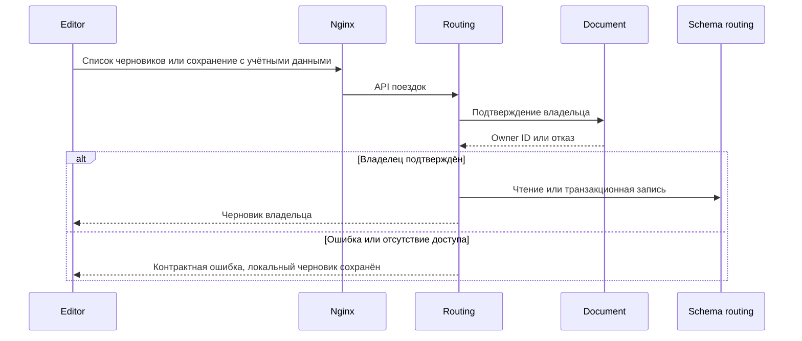
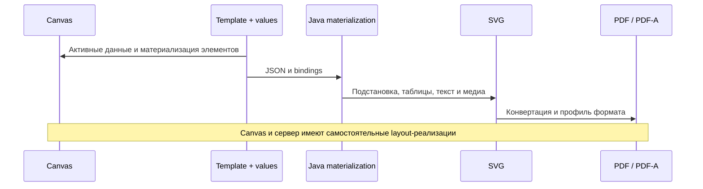

# API и границы совместимости

## Journey → CoDoc · ARC-022

`ShareModal` передаёт снимок `private-walk:complete` в текущий iframe-хост CoDoc. `TripWalkImport` хранит прогулку в выбранном визите Account Trip через `/api/routing/v1/trips`. `RoutePlacePanel` сохраняет дочерний снимок через `/api/journeys/routes` и присоединяет его к выбранной остановке существующей публикации. Фото проходят проверку лицензии в браузере и поступают в `/api/journeys/media` как байты. `GET /api/trips/{id}/pdf` читает сохранённую поездку и формирует карту, остановки и разрешённые фото. Старый `/api/trips/import-walk` сохраняет свой прежний синхронный формат проекции геометрии. Правила версий, обновления и прав описаны в [ADR 0004](decisions/0004-private-journey-handoff.md).

[Реестр методов и путей Spring MVC](architecture-evidence/rest-routes.csv) фиксирует 173 декларации с контроллерами и строками. [Реестр ссылок потребителей](architecture-evidence/rest-consumer-references.csv) содержит 348 нормализованных ссылок на локальные URL из клиентов, внутренних адаптеров и скриптов. [Сопоставление по маршрутам](architecture-evidence/rest-route-consumers.csv) сохраняет все пути, включая те, для которых место вызова статически не найдено. Совпадение шаблонов пути — кандидат вызова. Метод и контракт проверяются в указанной строке. Динамически составленные префиксы, внешние клиенты и маршруты Spring Security/Actuator описаны отдельно. Наличие контроллера само по себе не доказывает доступ через ingress, флаг или наличие потребителя в production.

| Владелец и семейство | Потребители и контракт |
| --- | --- |
| Document `/api/auth/*`, `/api/profile` | `ticket-editor/src/auth`, сессия HTTP клиента, WebView редактора. Access token и refresh cookie имеют разные роли. Google OAuth использует `/oauth2/` и `/login/oauth2/` через Nginx. |
| Document `/api/workspace/*`, `/api/templates/*`, `/api/history/*`, `/api/libraries/*` | Workspace, конструктор, библиотека, история. Данные владельца, версии и JSON слайдов. |
| Document `/api/schemas/*`, `/api/data-models/*`, `/api/connectors/*` | Панель данных, Excel, схемы, связки, интеграции. Элемент массива может использовать явную или историческую индексированную привязку. |
| Document `/api/generate*`, `/api/export/*`, `/api/recognition*` и `/api/guest/*` | Toolbar, generation coordinator, OCR/импорт и гостевой режим. Сохранённые модели доступны владельцу. Гостевая генерация принимает inline страницы и inline данные. Синхронный результат, задания, preview, PDF/PDF-A, ошибки размера и занятости являются контрактами. |
| Document `/api/journeys*`, `/api/journey-sites*`, `/api/publications*`, `/api/links/{code}` | Journey wizard, публичная ссылка, сканер/ключ, управление выпуском, альбом, печать и клиентский каталог. `kind=ALBUM` добавляет фильтр. Ключ управления и авторизация владельца обслуживают разные способы доступа. |
| Document `/api/journeys/routes*`, `/api/trips/*` | Публикационные снимки, совместимые публичные JSON/PDF/ICS, интеграции отелей/расписания/курсов. Новые черновики принадлежат Routing. Чтение v1 через `format=v1-compat` покрыто контрактным тестом. |
| Document `/api/workflows*`, `/api/public/workflows*`, `/api/email*`, `/api/client-keys*`, `/api/qr` | Builder и runner, публичный PDF/посещение, email UI, страница клиентского доступа, рендер QR. Клиентские интеграции также входят через Tyk `/client-api/`, который проксирует в Document. |
| Routing `/api/routing/v1/road` | Планировщик и Journey. Пары координат, промежуточные точки, геометрия, длительность и классифицированные ошибки провайдера. |
| Routing `/api/routing/v1/trips*` | `src/features/journeys/api/tripDraft.ts`, планировщик и сохранённые маршруты. Nginx направляет запросы напрямую в Routing, который получает подтверждение личности через Document. |
| Routing `/api/walks/v1/*` | Journey Web/APK, AddressInput, карта поездок и smoke-проверки. Поиск/обратный геокодинг, карты провайдеров, POI, маршруты, история. Ошибки занятости/таймаута и пустая выдача имеют различный смысл. |
| Nginx, Actuator и MCP | `/actuator/health` — служебный путь. Внешний Nginx закрывает его. Source proxy используется Journey. Конфигурация CORS/host/map влияет на доступ. Node OSM MCP и Python Ostrovok MCP предоставляют отдельные Streamable HTTP/JSON-RPC контракты. |

Пути без найденного вызова в локальных исходниках сохраняются в реестре. Возможны динамическая сборка URL, внешние интеграции и сохранённые публичные ссылки. Удаление по результату одной статической выборки недопустимо.

## Поток учётного черновика

## Заполнение и печать

Текущие проверки охватывают критические операции, например чтение старой поездки, таблицы из нескольких моделей, фильтр альбомов, права владельца, SVG preview и PDF/A кириллицу. Полного машинного контракта версий API в репозиториях не найдено. Для Phase 2 сохранить baseline маршрутов плюс golden JSON для error/status, разрешений, nullable/additive полей, бинарной выдачи и iframe сообщений. Сначала отчёт о расхождениях. Переключение на обязательную проверку по мере согласования baseline.

В diff последнего backend-коммита с его родителем единственное изменение деклараций контроллеров — новый GET `/api/walks/v1/addresses/city` (`routing-service/src/main/java/ru/ticket/walks/web/WalkAddressesController.java:20–24`). Это локальная проверка additive-маршрута. Остальные свойства совместимости оцениваются по HTTP-тестам и fixture.
