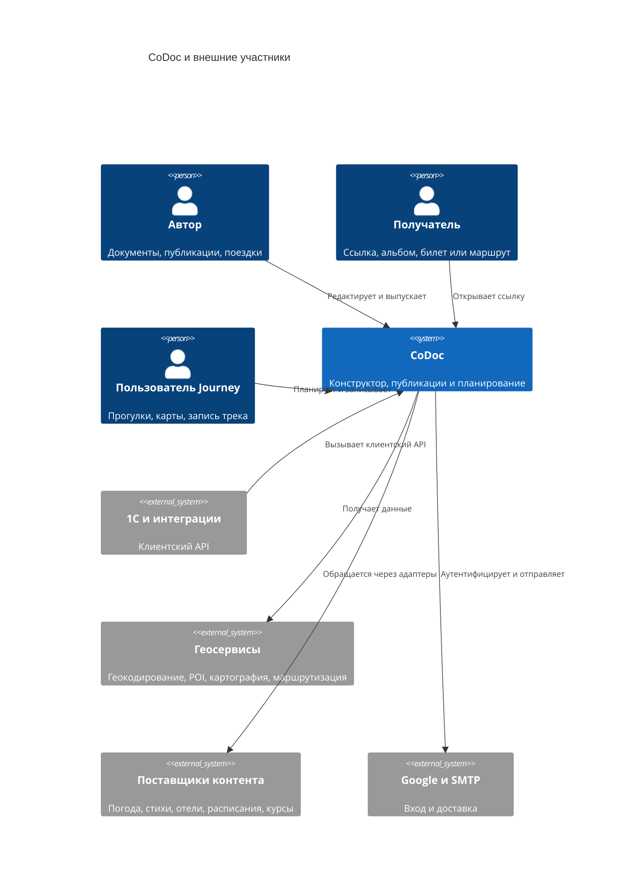
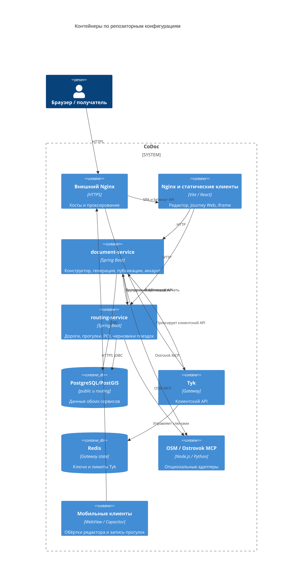
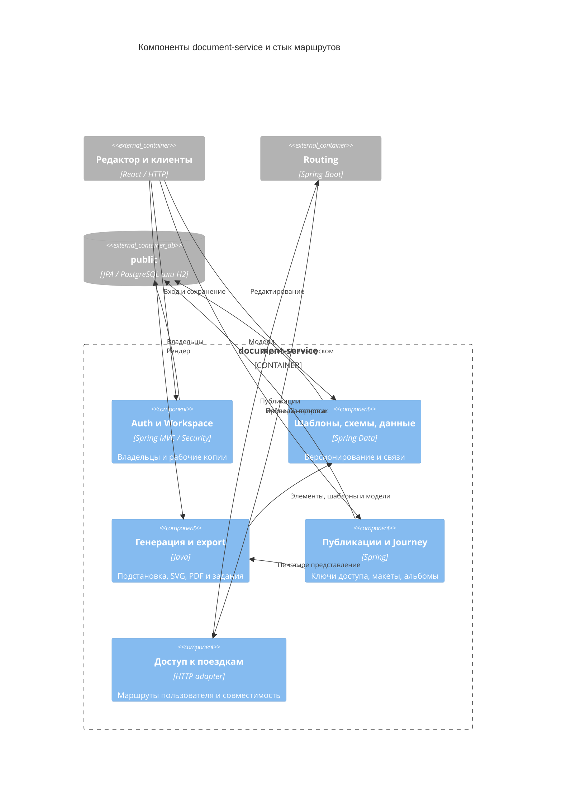
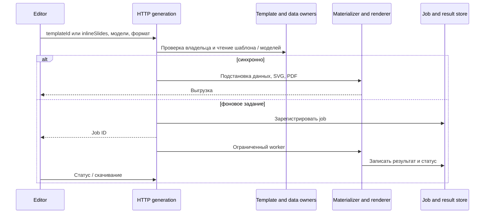

# CoDoc · фактическая архитектура

Аудит привязан к [четырём ревизиям и условиям запуска](architecture-evidence/BASELINE.md). Источник для выводов — локальные исходники и конфигурации этих ревизий. Состояние production, фактические нагрузки и данные пользователей в аудит исходников не входят. Ранее составленные [материалы Journey](current-state.md) описывают историю разделения сервисов.

[Целевое состояние](ARCHITECTURE-TO-BE.md) · [Границы модулей](MODULE-BOUNDARIES.md) · [ARC-001–ARC-016 и backlog](ARCHITECTURE-BACKLOG.md) · [ADR 0003](decisions/0003-architecture-hardening-in-place.md)

## Контекст C4

## Контейнеры C4

Nginx, Java сервиса документов и оба веб-дистрибутива поставляются в одном образе `codoc-app`. H2 остаётся поддерживаемым вариантом. Реестр вариантов, ресурсов и проверок находится в [DEPLOYMENT-ARCHITECTURE](DEPLOYMENT-ARCHITECTURE.md).

## Точки входа

[Опись модулей и пакетов](architecture-evidence/module-inventory.csv) перечисляет узлы графа обоих SPA, двух Java-сервисов и Android-обёрток.

| Репозиторий / приложение | Вход и роль |
| --- | --- |
| `ticket-editor` Web | `index.html`, `src/main.tsx:16`, `src/App.tsx:87–149`. Публичные страницы, рабочая область, конструктор, каталог, генерация, публикации, workflows и поездки. |
| `ticket-editor` карта | Отдельный Vite input `map-frame.html` в `vite.config.ts:73`. Отрисовка снимка карты и сообщения iframe. |
| `ticket-editor` Android / iOS | `mobile/android/app/src/main/AndroidManifest.xml` и `site/codoc/mobile/MainActivity.java`. `mobile/ios/CoDoc/CoDocApp.swift` и `WebEditor.swift`. Обёртки веб-редактора с нативной интеграцией загрузок. |
| `private_jorney` Web | `index.html:16` → `src/main.tsx` → `src/infrastructure/index.ts` и presentation. Веб и встраивание в CoDoc по `/private-journey/`. |
| `private_jorney` Android | `android/settings.gradle:1–5`, `android/app/src/main/AndroidManifest.xml`, `MainActivity.java`. Capacitor-плагины `WalkRecorder` и `PublicSources`, foreground service `WalkRecordingService`. TypeScript-порты оборачивают Web и native реализации. |
| `ticket-pdf/document-service` | `document-service/src/main/java/ru/ticket/ExportApplication.java:8–14`. Maven artifact `ticket-pdf`. Spring MVC, JPA и PDF-композиция. |
| `ticket-pdf/routing-service` | `routing-service/src/main/java/ru/ticket/routing/RoutingApplication.java:12–20`. Spring сканирует `routing` и `walks`, JPA сканирует поездки и прогулки. |
| `ticket-infra` | `deploy.sh`, `scripts/migrate-postgres.sh`, `scripts/deploy-postgres.sh`, Compose/Nginx/Tyk, OSM MCP и `mcp/ostrovok/server.py`. Мигратор `ticket-pdf/document-service/tools/H2ToPostgres.java` запускается отдельной сборочной целью. |

## Компоненты C4

## Критический поток генерации

## Внешние адаптеры и отказы

[Упоминания внешних хостов](architecture-evidence/provider-host-references.csv) позволяют найти конфигурацию и вызовы по файлу и строке. Реестр включает литералы в CSP и ссылках, а не только сетевые вызовы. Адреса из переменных окружения сверяются по контракту адаптера.

| Область | Провайдер и владелец | Поведение, видимое в коде |
| --- | --- | --- |
| Дорога | Routing, `CalculateRoad`, `BRouterRoadRouter`, `BRouterHttpRoadRouter`, `ValhallaRoadRouter`, `OsrmFossgisRoadRouter` | Порядок источников зависит от конфигурации. Timeouts и классификация отсутствия пути/лимита. Локальный BRouter требует сегменты. |
| POI и история | Routing, `WalkThemeService`, `AreaSearchCoordinator`, OSM Overpass, OSM MCP, Photon, Wikimapia, Wikimedia/Commons, HOITH | Ограниченные источники, частичная выдача и кэши. MCP опционален. Импорт HOITH имеет отдельные ограничения и подготовку spatial БД. |
| Адрес и город | Routing `AddressSearchService`, Photon. Document `NominatimCitySearch` для прежней поверхности выбора города. | Общий лимит Photon и TTL. Обратный поиск может вернуть пустой город. Неустановленный Nominatim даёт контролируемый отказ этого API. |
| Карты в UI | Editor `LeafletTripMap`, `RouteMap`, `VectorRouteMap` и map-frame. Journey `MapView` и адаптеры тайлов. | Отрисовка и внешние тайлы отдельны от вычисления геометрии. Передача прогулки в iframe проверяет тип, origin и канал. |
| Стихи и погода | Document `PoetrySourceChain`, `PoemShipProvider`, PoetryDB, PoeTree, Wikisource, `PoetryWeatherService` | Последовательный fallback и ограниченные кэши. Нехватка проверенных стихов возвращает явную ошибку. Запрос без погоды поддержан. |
| Поездки | Document `journey/infrastructure` и `journey/web/trip`. Ostrovok MCP, Яндекс Расписания, Банк России. | При отказе отельного источника предусмотрен статический реестр без обещаний доступности. Расписание и курсы имеют самостоятельные бюджеты и кэши. |
| Публичные карточки Journey | `private_jorney/src/infrastructure/api`, `PublicSourcesPlugin` и Nginx source proxy. Citywalls, Gorod+, городские наборы данных. | Адаптеры страниц и локальные данные, геопривязка и ручное открытие ссылки. Доступность поставщика и нативный browser channel влияют на полноту карточки. |
| Вход, доставка, OCR | Google OAuth, JWT/refresh, SMTP, Tesseract, PDFBox. | Вход с локальным паролем и Google — разные входы. SMTP имеет отдельную очередь и журнал. OCR запускает локальный процесс с лимитами. |
| Документы и подпись | Draw.io, WebView, CryptoPro на клиенте. | Диаграмма передаётся через iframe. Подпись зависит от доступности локального плагина и сертификата. |
| Метрики и обратная связь | Editor, Яндекс Метрика и формы. | Отдельные браузерные интеграции. Подгрузка формы и CSP проверяются клиентскими тестами. |

Связи по исходникам и реальные потребители описаны в [DEPENDENCY-REPORT](DEPENDENCY-REPORT.md) и [API-CONTRACTS](API-CONTRACTS.md). [DATA-OWNERSHIP](DATA-OWNERSHIP.md) фиксирует таблицы, транзакции, кэши и очереди.
