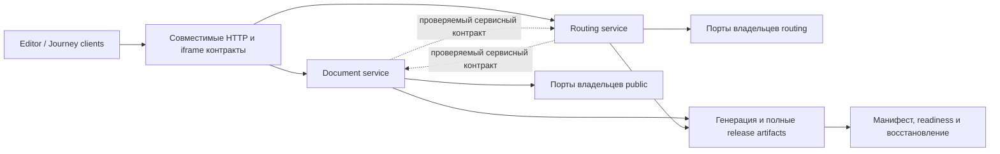

# CoDoc · целевое состояние после поэтапного усиления

Сохранить существующие сервисы и клиентские приложения. [Цель Journey](target-state.md) остаётся описанием продуктового сценария. Этот документ задаёт границы и требования к проверке общих изменений. Порядок работ и отката задан в [ARCHITECTURE-BACKLOG](ARCHITECTURE-BACKLOG.md).

## Приоритеты

1. **Управляемый runtime.** Готовность отражает состояние Java и обязательных локальных ресурсов. Ошибка получения маршрутов влияет на соответствующие операции. Старт конструктора при недоступном Routing проверяется отдельным сценарием. Ресурсные лимиты и бюджеты сравниваются для каждого поддерживаемого Compose-профиля.
2. **Полные версионированные артефакты.** Временный процесс работы с JAR сужается к исключению. Целевой выпуск опирается на полные проверенные артефакты и манифест из commit SHA, digest, совместимости схем и smoke-проверок.
3. **Один владелец данных.** Публикации, рабочий черновик, история, печатный снимок и экспортируемый документ получают явные правила чтения и обновления. Разделение схем уже существует. Контроль предотвращает случайные новые зависимости между схемами.
4. **Проверяемые границы.** Публичные входы frontend-модулей уменьшают доступ к внутренним stores. Порты Java отвязывают сценарии от Spring Data и PDF-адаптеров. Общие части JSON/Canvas/SVG/PDF сверяются на fixture-наборах с допусками.
5. **Испытанное восстановление.** Порядок backup, миграции, публикации и возврата проверяется на disposable окружении. RPO и RTO принимаются только после измерений.

## Последовательность включения проверок

- Публикуется диагностический отчёт с полным графом и перечнем известных отклонений. Он имеет owner и срок актуальности. Набор обязательных правил продолжает действовать.
- Для нового непредусмотренного ребра и несовместимого API требуется отдельное обоснование. После переноса одного сценария объём исключений уменьшается. Старые ошибки остаются видимыми до устранения.
- Версионирование и release manifest внедряются совместимо с прошлым runtime. После перехода на новую проверку временная поддержка старого пути удаляется только в отдельной задаче с подтверждением обратной совместимости.

См. [ADR 0003](decisions/0003-architecture-hardening-in-place.md).
