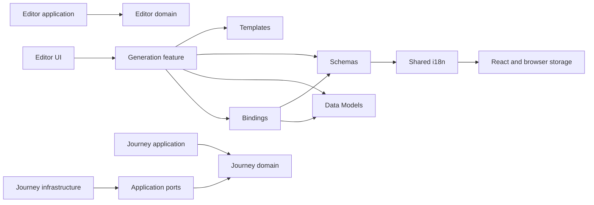
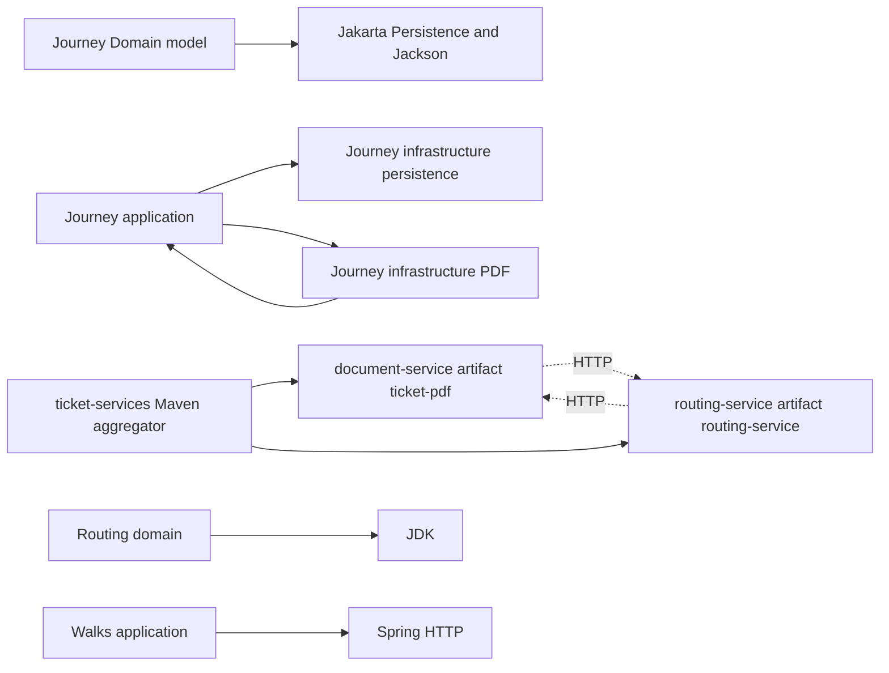

# Графы зависимостей и архитектурные проверки

## Как читать графы

- TypeScript. `dependency-cruiser` читает `tsconfig` и учитывает type-only. Штатный запуск Editor выполняется с `.dependency-cruiser.cjs`, дополнительный запуск отчётности сохраняет внешние импорты. [Editor — рёбра файлов](architecture-evidence/editor-imports.csv), [модули](architecture-evidence/editor-module-edges.csv). [Journey — рёбра файлов](architecture-evidence/walks-imports.csv), [модули](architecture-evidence/walks-module-edges.csv).
- Java. [Импорты с файлами и строками](architecture-evidence/java-imports.csv), [пакетный граф на исходниках](architecture-evidence/java-package-import-edges.csv), [пакетный граф байткода](architecture-evidence/java-bytecode-package-edges.csv). Второй граф получен через `jdeps -verbose:package -filter:none --multi-release 17`. Динамическое связывание Spring, JPQL, reflection и сетевые вызовы не видны как Java-импорты.
- Android. [Импорты нативных Java-пакетов](architecture-evidence/android-java-imports.csv). Capacitor JS bridge и вызовы ОС учитываются по документации и точкам входа.
- Maven. [Прямые и управляемые зависимости](architecture-evidence/maven-direct-dependencies.csv) и [runtime-библиотеки упакованных JAR](architecture-evidence/maven-packaged-runtime-libs.csv). Корневой `ticket-services` агрегирует два модуля. Оба наследуют Spring Boot parent, межартефактного ребра нет. HTTP даёт runtime-связь вне Maven.
- Сильно связные компоненты (SCC) сохранены в [cycles.csv](architecture-evidence/cycles.csv). Цикл укрупнённых пакетов или features не равен циклу загрузки отдельных файлов. Внешние импорты исключаются из подсчёта SCC проекта.

| Граф | Исходных модулей/файлов | Проектные рёбра | Runtime-классификация и SCC |
| --- | ---: | ---: | --- |
| Editor, TS | 632 | 2049 файловых | 1618 не помечено type-only, 0 файловых SCC, 1 SCC укрупнённых модулей. 90 межfeature-импортов, 75 из них не type-only. |
| Journey, TS | 163 | 478 файловых | 305 не помечено type-only, 1 файловая SCC с type-only связью и 0 после её исключения. 0 runtime SCC модулей. |
| Document, Java | 392 | 254 внутренних пакетных с импортов, 283 с байткода | 5 импортных пакетных SCC, 6 по байткоду. |
| Routing, Java | 80 | 36 внутренних пакетных с импортов, 34 с байткода | 2 пакетные SCC в обоих графах. |

В Editor диагностический резолвер пометил `maplibre-gl` в `src/features/journeys/ui/VectorRouteMap.tsx` как unknown. Штатный Vite build и проверка типов приложения проходят. Маркер фиксирует предел статического резолвера.

## Характерные зависимости

- Цикл Journey TypeScript соединяет `summarizeBuildingMaintenance.ts` и `summarizeBuildingProfile.ts` через тип.
- Editor SCC из 14 укрупнённых узлов охватывает workspace, presentation, features и marketing. Например, Generation знает внутренние stores Templates/Schemas/Models, а Bindings читает Schemas и Models. [Публичные границы](MODULE-BOUNDARIES.md).
- `src/features/schemas/domain/SchemaInference.ts:1` → `src/shared/i18n/index.ts:1–2` → React и `src/shared/i18n/core.ts:26` (localStorage). Аналогичная цепочка есть у BindingResolver. [Диагностика Editor](architecture-evidence/editor-domain-platform.csv), [Journey](architecture-evidence/walks-domain-platform.csv). Диагностика browser API использует текстовый поиск и даёт кандидатов. Приведённые примеры проверены по исходникам.
- Document SCC по байткоду включает Auth/Client API/Config, Generation DTO/port, History/Template/Workspace services, Journey/Workflow, Recognition и SVG/Text. Routing SCC связаны с Trip persistence и взаимоотношением Walks history/MCP/POI. Инъекция Spring требует отдельной проверки.
- Прямые обращения к адаптерам перечислены в [ARC-001/005](ARCHITECTURE-BACKLOG.md). Реестр импортов различает port и Spring Data, связывая их с исходными файлами.

## Действующие и предлагаемые проверки

| Область | Сейчас | Первый диагностический шаг Phase 2 |
| --- | --- | --- |
| TS циклы | Editor `npm run check:arch`, `.dependency-cruiser.cjs:10–17`. Дублирующую конфигурацию в `src/.dependency-cruiser.cjs` этот npm script не использует. В Journey отдельного gate не найдено. | Два отчёта по каждому клиенту, все импортные связи и отдельно runtime. Список известных type-only циклов. |
| Application → Infrastructure | Editor правило Application проверяет UI. Прямого импорта в адаптеры нет по графу. Java дорожное ядро ArchUnit блокирует зависимость. | Diagnostic checks по реальным path rules обоих TS и по Java Journey/Walks. |
| Доменные платформы | Editor `domain-framework-free` выбирает только верхний `src/domain/` и не проверяет транзитивный reachability. `node_modules` исключён конфигурацией. Java Journey запрещает внутренние верхние слои, при этом домен использует JPA/Jackson. | Отчёт по прямым и транзитивным runtime edges с причинным путём. Synthetic fixture для React/DOM/JPA. |
| Междоменные импорты и public API | Явного правила для `features/*` в Editor не найдено. Java проверяет отдельные пакеты, междоменные SCC и Repository не покрыты. | Разрешённые DTO/порты/фасады, отчёт о deep import и Repository другого домена. Архитектурный тест на новое отклонение. |
| Проверка типов | Editor `check` запускает product/test/e2e typechecks. Journey `build` начинает с `tsc --noEmit`. | Восстановить красный baseline тестовых типов отдельным PR с той же строгостью. Включить контракты публичных фасадов в матрицу типов. |
| Совместимость HTTP | JUnit contract cases, Playwright и ручные smoke, без общего машинного gate. | Snapshot route+status+payload и HTTP error/visibility diff, включая публичные, гостевые и legacy fixtures. |

Действующие обязательные проверки не изменены. Дополнительные графы получены локально. Будущие диагностики должны сохранять baseline известных дефектов и отслеживать новые, затем переходить к обязательным по одному правилу.
