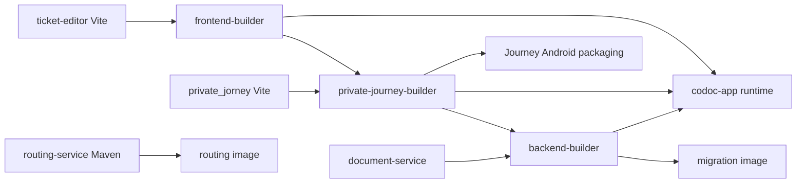
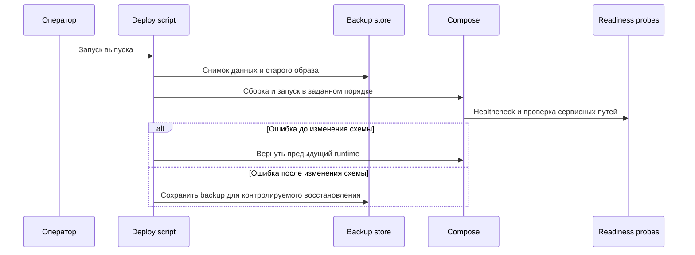

# Развёртывание и восстановление CoDoc

Это карта репозиторных конфигураций. Рабочие production-конфигурации, секреты, фактическая загрузка и данные на сервере не читались.

| Вариант | Источники `ticket-infra` | Как работает |
| --- | --- | --- |
| H2 и внешний Nginx | `deploy.sh`, `compose.routing.yml`, `compose.gateway.yml`, `nginx.external.conf` | Скрипт разворачивает legacy-контейнер приложения и управляет Routing и шлюзом отдельно. У каждого сервиса свой H2 storage. |
| Основной Compose | `compose.api.yml` с включённым `compose.routing.yml` | App и Routing. Tyk/Redis в той же конфигурации, профиль `ostrovok-mcp` опционален. App при запуске требует healthy Routing. |
| PostgreSQL/PostGIS | `compose.api.yml` + `compose.postgres.yml`, `scripts/deploy-postgres.sh`, `scripts/migrate-postgres.sh` | PostgreSQL и схемы `public`/`routing`, отдельные program profiles. Мигратор включается профилем `tools` при переносе. |
| PostgreSQL с OSM MCP | Базовый и Postgres Compose + `compose.walks.yml` | Дополнительный OSM мост без публикации порта. Routing может использовать прямой источник. |
| Отдельный шлюз | `compose.gateway.yml`, `tyk/apps/codoc.json`, `API-GATEWAY.md` | Tyk и Redis. Используется H2/клиентским API и схемами с выделенным gateway. Не складывать его ресурсы с inline Tyk, если поднят только один вариант. |
| Внешний, внутренний и wildcard Nginx | `nginx.external.conf`, `nginx.conf`, `nginx.journeys.conf`, `nginx.private-sources.conf`, `nginx.public-source-headers.conf` | TLS/host routing, статика, ограничения размера и частоты, headers/CSP, отдельные upstream для API. Внешний ingress закрывает actuator. |
| Публичные страницы и мобильные клиенты | `ticket-editor/.github/workflows/deploy.yml`, `ticket-infra/scripts/build-private-apk.ps1`, `ticket-editor/mobile` | GitHub Pages публикует статический сайт с собственным base path. APK собирается отдельно. Веб-публикация его не обновляет. |

## Сборка и совместные артефакты

`Dockerfile:43–68` использует промежуточные COPY как барьеры сборки под низкий бюджет. `Dockerfile:119–146` показывает отдельный Routing image и совместный runtime App. Образ App содержит Java JAR, внутренний Nginx, редактор и Journey Web. PDF-шрифты и OCR также относятся к этому runtime. В маршрутизации покомпонентные сборки и пересоздание Compose имеют разные пути отката.

## Лимиты по конфигурации

| Сервис | Память | CPU | Точка проверки |
| --- | ---: | ---: | --- |
| App | 1408 MiB | 1.5 | `compose.api.yml:45,60–64`. Java heap 832 MiB, direct 128 MiB. |
| Routing | 640 MiB | 1.0 | `compose.routing.yml:10–12,43–46`. Java heap 192 MiB и один active processor в Dockerfile. |
| PostGIS | 512 MiB | 0.75 | `compose.postgres.yml:12–14,48–51`. |
| Inline Tyk / Redis | 160 / 128 MiB | Проверять профиль | `compose.api.yml:86–113`. Tyk получает `GOMEMLIMIT=300MiB`. |
| Отдельный Tyk / Redis | 384 / 160 MiB | Проверять профиль | `compose.gateway.yml:4–28`. Тот же Go soft limit помещается в configured cap, нужен запас для остальной памяти. |
| Ostrovok / OSM MCP | 64 / 256 MiB | 0.15 / 0.5 | `compose.api.yml:73–80`, `compose.walks.yml:3–13`. |
| Мигратор | 768 MiB | 1.0 | `compose.postgres.yml:79–99`. Профиль `tools`, планировать как отдельную процедуру. |

Номинальная сумма лимитов основного Postgres стека — 2848 MiB, с обоими опциональными MCP — 3168 MiB до расходов хоста. Это сумма верхних пределов, не измерение RSS. Уже лимиты App, Routing и PostGIS составляют 3.25 CPU, что допускает конкуренцию за 2 CPU хоста. Для машины с 2 GiB RAM нужны измерения и отдельный согласованный профиль. Инструкции и текущие build-ограничения сохранены в `ticket-infra/RESOURCE-BUDGET.md`, `buildkitd-low-memory.toml`, `scripts/lib/low-memory-build.sh`.

## Выпуск, проверка и откат

| Операция | Артефакт и подтверждение | Откат |
| --- | --- | --- |
| Полная сборка | `deploy.sh` и Postgres-скрипт используют исходники четырёх репозиториев, low-memory build и проверки после запуска. H2 записывает исходные ревизии и делает архив каталога. | До изменения схемы восстанавливаются предыдущие процессы. После изменения схемы оставляется остановленное состояние для отдельного решения по данным. |
| Частичная статика | `runtime_publish.py web` пакует dist. Remote сохраняет Docker tag, копирует ресурсы и `index.html` последним. Проверяет тело ответа внутреннего Nginx. | Предыдущий образ/снимок ресурсов. Старые хешированные assets сохраняются. Следует проверять совпадение всех точек входа, CSP и внутренних/внешних URL. |
| Частичный backend | `runtime_publish.py:55–71`, `runtime_publish_remote.py:92–134` накладывают class files на имеющийся JAR, дополняют образ и перезапускают Java. Валидируются ZIP, SHA payload и код 200. | Возвращаются предыдущий JAR и тег. Нет доказательства, что результат побайтово соответствует воспроизводимой сборке commit SHA. |
| Миграция и выпуск PostgreSQL | Backup и image reference до схемы, `psql -v ON_ERROR_STOP=1 --single-transaction` по файлам, переход H2 отдельно. | H2 rollback и остановка после необратимых этапов описаны в `POSTGRES-MIGRATION.md:61–73`. PostgreSQL restore с проверкой бизнес-инвариантов остаётся отдельным контролем. |

Контейнерный healthcheck App принимает HTTP 401 (`compose.api.yml:64`), миграционный bootstrap тоже (`scripts/migrate-postgres.sh:102–106`). Скрипт runtime-публикации требует HTTP 200, но используемый по умолчанию endpoint capabilities не доказывает доступ к данным. Восстановление следует проверять на временной БД с синтетическими данными и отдельно проверять наличие согласованных файлов, ревизий и образов. Обоснование и критерии — [ARC-009–016](ARCHITECTURE-BACKLOG.md).
